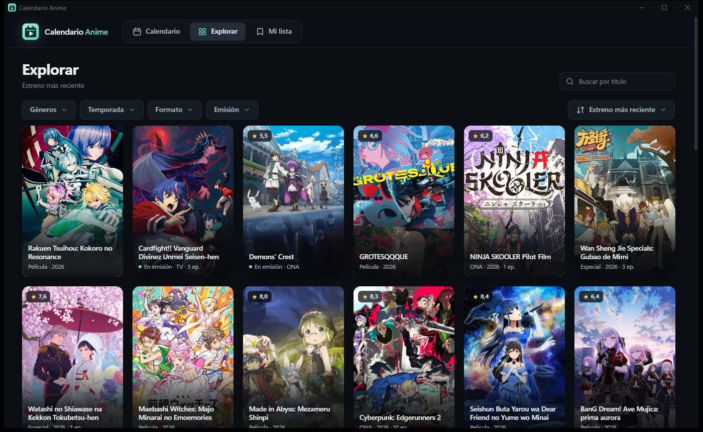

# Calendario Anime



Aplicación de escritorio para Windows 11 que muestra qué anime se emite cada día y a qué hora, con un directorio visual para descubrir series y tu lista de MyAnimeList integrada. Está en español y no necesita cuentas ni claves de API.

## Descarga

Descarga `CalendarioAnime.exe` desde la [última versión publicada](https://github.com/Dreex14/calendario-anime/releases/latest) y ábrelo. Es un único ejecutable de 1 MB y no necesita instalación.

Como no está firmado digitalmente, Windows SmartScreen puede mostrar un aviso la primera vez. Para abrirlo, pulsa **Más información** y luego **Ejecutar de todas formas**.

## Qué hace

- **Calendario.** Muestra la semana día a día, con la portada, el título, el episodio y la hora de cada emisión. Las horas son las de la emisión original en Japón convertidas a tu hora local. Puedes ver todo, solo los animes populares o solo los de tu lista. En el día de hoy, los episodios ya emitidos quedan recogidos en un botón.
- **Explorar.** Muestra una cuadrícula de portadas que se adapta al tamaño de la ventana, con desplazamiento infinito. Los filtros son de selección múltiple por género (si eliges varios, se muestran los animes que los tienen todos), temporada y año, formato y estado de emisión. Por defecto ordena por estreno más reciente; también puede ordenar por popularidad, puntuación o nombre, y el botón de la flecha invierte el orden. El buscador por título es opcional.
- **Ficha.** Incluye la sinopsis traducida al español, los datos principales y la fecha del próximo episodio. Desde ella puedes marcar el anime como *Viendo*, *Pendiente* o *Completado*, o como favorito. También puedes guardar el enlace a la página donde ves la serie (por ejemplo, Crunchyroll): después, el botón **Ver anime** la abre en tu navegador. La aplicación no busca enlaces ni reproduce nada por su cuenta.
- **Mi lista.** Escribe tu usuario o el enlace de tu perfil de MyAnimeList para importar los animes que estás viendo, los pendientes, los completados y los favoritos. No hace falta iniciar sesión, pero la lista tiene que ser pública. Los cambios que hagas desde la aplicación se conservan aunque vuelvas a sincronizar. La lista se sincroniza sola en segundo plano cada 6 horas.

La aplicación recuerda el tamaño y la posición de la ventana, la última sección y los filtros. Las respuestas se guardan en caché y se muestran al instante mientras se actualizan en segundo plano. Las portadas se guardan en la caché del navegador integrado durante 31 días. Pulsa **F5** para forzar una actualización.

## Fuentes de datos

| Fuente | Uso |
| --- | --- |
| [AniList](https://docs.anilist.co/) (API GraphQL pública) | Horarios de emisión, directorio, fichas y portadas |
| Lista pública de [MyAnimeList](https://myanimelist.net/) (`animelist/<usuario>/load.json`) | Animes viendo, pendientes y completados |
| Perfil público de MyAnimeList, con [Jikan](https://jikan.moe/) como alternativa | Favoritos |
| [MyMemory](https://mymemory.translated.net/) | Traducción de las sinopsis al español (se guarda en caché) |

La API v4 de Jikan ya no ofrece las listas personales de anime, así que la lista se lee directamente del JSON público que usa la propia web de MyAnimeList. La aplicación no reproduce ni descarga episodios.

## Compilar

```powershell
powershell -NoProfile -ExecutionPolicy Bypass -File .\Compilar.ps1
```

Genera `dist\CalendarioAnime.exe` con el compilador de C# incluido en Windows (.NET Framework 4.8), así que no hace falta instalar nada. La interfaz (`web/`) y las bibliotecas de WebView2 (`lib/`) se incrustan en el ejecutable. Para trabajar en la interfaz sin recompilar, compila con `-Desarrollo` y define `CALENDARIO_WEB` con la ruta de la carpeta `web`. El ejecutable normal no tiene ese modo.

Al arrancar, la aplicación comprueba la huella SHA-256 de las bibliotecas de WebView2 extraídas y las restaura desde el ejecutable si no coinciden.

Los datos se guardan en `%LOCALAPPDATA%\CalendarioAnime`: `datos.json` contiene la lista y las preferencias, y `ventana.txt`, la posición de la ventana.

## Licencia y créditos

Hecho por **Dreex**. El código propio se publica con la [licencia MIT](LICENSE). Copyright © 2026 Dreex.

| Dependencia | Licencia |
| --- | --- |
| [Microsoft Edge WebView2](https://developer.microsoft.com/microsoft-edge/webview2/): el SDK está en `lib/` y el entorno de ejecución viene incluido en Windows 11 | Licencia de Microsoft, en [`lib/LICENSE.txt`](lib/LICENSE.txt) |

Los datos y las portadas pertenecen a AniList, MyAnimeList y sus respectivos titulares.

El autor no se hace responsable del uso del programa ni del contenido que se obtenga con él.
